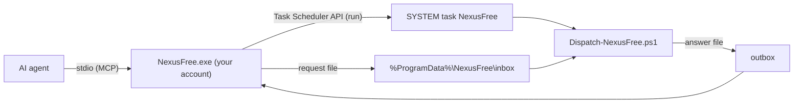

<div align="center">

<a href="https://julienpiron.fr/nexusfree/"></a>

# NexusFree

**Admin rights for your AI. Without the UAC prompt.**

Administrator and `SYSTEM` commands for your AI coding agents on Windows: one MCP server shared by Claude Code, Codex
and Antigravity, after a single elevation at install time.

[](https://github.com/pironjulien/NexusFree/actions/workflows/tests.yml)
[](https://scorecard.dev/viewer/?uri=github.com/pironjulien/NexusFree)
[](https://github.com/pironjulien/NexusFree/releases/latest)
[](#-install)
[](#-tools)
[](LICENSE)

[🌐 Website](https://julienpiron.fr/nexusfree/) · [📦 Get it with NexusSystem](https://github.com/pironjulien/NexusSystem) · [📝 Changelog](CHANGELOG.md)

</div>

An agent working in the background cannot answer a UAC prompt, so `sfc`, `dism`, services, `HKLM` keys, drivers or
installers fail. NexusFree runs those commands under `SYSTEM` for **one Windows account, the one that installed it**,
after a single elevation at install time.

> [!WARNING]
> **What this means.** Installing NexusFree turns that account into one that can act as `SYSTEM` without confirming
> each time: any program running under it, not only your AI agents, can use it. Install it only on a PC you own, for
> an account you already use as an administrator, and treat the agents' commands as you would your own. Other Windows
> accounts on the PC get no access. See [SECURITY.md](SECURITY.md).

## ✨ Why NexusFree

<table>
<tr>
<td width="33%">🛡️ <b>One UAC prompt, at install</b><br>Later runs, updates included, go through NexusFree itself.</td>
<td width="33%">👤 <b>One authorized account</b><br>Only the account that installed it can queue commands; other accounts get no access.</td>
<td width="33%">📜 <b>Every command logged</b><br>Each request run under <code>SYSTEM</code> is written to <code>logs\elevation.log</code>.</td>
</tr>
<tr>
<td>🤝 <b>One server, three AI apps</b><br>The same two tools in Claude Code, Codex and Antigravity.</td>
<td>🌍 <b>Any Windows language</b><br>Access rights are set by SID, so the install works whatever the system language.</td>
<td>⚡ <b>Native engine</b><br>A C# (.NET 10) stdio MCP server, x64 and ARM64.</td>
</tr>
</table>

## 🧰 Tools

- `free(command, timeout_seconds=600)`: runs a PowerShell command line under `SYSTEM` and returns its exit code and
  output (stdout, then stderr).
- `free_status()`: whether the `SYSTEM` task and the spool are installed.

## 🚀 Install

Windows 10 or 11, as the account that will use it (not another account's elevated prompt).

> [!TIP]
> **Let your AI install it.** NexusFree is opt-in in NexusSystem: it is installed only when you name it. Paste into
> Claude Code, Codex or Antigravity:
>
> ```text
> Install NexusFree for me by following https://raw.githubusercontent.com/pironjulien/NexusSystem/main/INSTALL-AI.md
> ```
>
> Or with the [NexusSystem](https://github.com/pironjulien/NexusSystem) pack script: `get-nexus.ps1 -Only free`.

<details>
<summary><b>Manual install (verified)</b></summary>

From the latest release, as a file, never from memory (read [SECURITY.md](SECURITY.md) first):

```powershell
$r = 'https://github.com/pironjulien/NexusFree/releases/latest/download'
Invoke-WebRequest "$r/get.ps1" -OutFile get.ps1
Invoke-WebRequest "$r/SHA256SUMS.txt" -OutFile SHA256SUMS.txt
(Get-FileHash get.ps1 -Algorithm SHA256).Hash    # must equal the get.ps1 line of SHA256SUMS.txt
gh attestation verify get.ps1 --repo pironjulien/NexusFree   # optional: provenance
powershell -NoProfile -ExecutionPolicy Bypass -File .\get.ps1
```

get.ps1 downloads `NexusFree-win-x64.zip` or `NexusFree-win-arm64.zip` (this PC's architecture), checks its SHA-256
against the release's `SHA256SUMS.txt` before extracting anything, unpacks it into
`%USERPROFILE%\.nexus\nexus-free\releases\<version>`, then runs its `install.ps1 -Apply`.

From the source:

```powershell
git clone https://github.com/pironjulien/NexusFree
powershell -NoProfile -ExecutionPolicy Bypass -File NexusFree\install.ps1 -Apply
```

From the source it builds the engine with the .NET 10 SDK; from a release package (`NexusFree-win-x64.zip`,
`NexusFree-win-arm64.zip`, checked against the release's `SHA256SUMS.txt`), the engine is already built. The `SYSTEM`
side needs one UAC prompt; later runs (updates) go through NexusFree itself. Claude Code and Codex get the plugin from
the [NexusSystem](https://github.com/pironjulien/NexusSystem) catalog; `install.ps1` declares it to Antigravity.

</details>

## ⚙️ How it works



- **Engine** (`src/NexusFree`): native C# (.NET 10) stdio MCP server, also `--status`, `--exec "<command>"` and
  `--version`.
- **Dispatcher** (`daemon/Dispatch-NexusFree.ps1`), installed in `%ProgramFiles%\NexusFree`: the scheduled task's
  only action, under `SYSTEM`. It moves each request out of the inbox, checks that its file belongs to the authorized
  account, runs it, and writes the answer to the outbox (a temporary file renamed once complete). Every command is logged in `logs\elevation.log`; the engine removes answers nobody collected after 24 hours.

<details>
<summary><b>Access rights</b> (<code>daemon/setup-system.ps1</code>, by SID so any Windows language works)</summary>

| Path | SYSTEM, Administrators | Authorized account | Other accounts |
|---|---|---|---|
| `%ProgramFiles%\NexusFree` (dispatcher, `config.json`) | full | read | read |
| `%ProgramData%\NexusFree\inbox`, `outbox` | full | modify | none |
| `%ProgramData%\NexusFree\logs` | full | read | none |
| `%ProgramData%\NexusFree\staging` | full | none | none |
| Scheduled task `NexusFree` | full | read, run | none |

</details>

## 🗑️ Uninstall

From an elevated prompt:

```powershell
Unregister-ScheduledTask -TaskName NexusFree -Confirm:$false
Remove-Item -Recurse -Force "$env:ProgramFiles\NexusFree", "$env:ProgramData\NexusFree"
```

Then remove `%USERPROFILE%\.nexus\nexus-free` and the `nexus-free` plugin from your AI apps.

## 🛠️ Development

`test.ps1` runs the xUnit suite (MCP protocol, no elevation needed). Build outputs go to
`%USERPROFILE%\.nexus\build\nexusfree`. Changes are listed in [CHANGELOG.md](CHANGELOG.md).

## 🔐 Privacy & security

Everything runs on your PC; the only privileged path is the `SYSTEM` task above, limited to the authorized account.
GitHub releases are immutable and carry checksums and build provenance. To report a vulnerability, see
[SECURITY.md](SECURITY.md).

---

<div align="center">

### Part of the Nexus ecosystem

Your AIs (Claude, Codex, Antigravity) at work on your Windows apps, real Chrome and Android phone — in the background.

<table>
<tr>
<td align="center" width="96"><a href="https://github.com/pironjulien/NexusSystem"><br><sub><b>NexusSystem</b></sub></a></td>
<td align="center" width="96"><a href="https://github.com/pironjulien/NexusWindows"><br><sub><b>Windows</b></sub></a></td>
<td align="center" width="96"><a href="https://github.com/pironjulien/NexusBrowser"><br><sub><b>Browser</b></sub></a></td>
<td align="center" width="96"><a href="https://github.com/pironjulien/NexusAndroid"><br><sub><b>Android</b></sub></a></td>
<td align="center" width="96"><a href="https://github.com/pironjulien/NexusRelay"><br><sub><b>Relay</b></sub></a></td>
</tr>
<tr>
<td align="center" width="96"><a href="https://github.com/pironjulien/NexusKeypad"><br><sub><b>Keypad</b></sub></a></td>
<td align="center" width="96"><a href="https://github.com/pironjulien/NexusAGYmail"><br><sub><b>AGYmail</b></sub></a></td>
<td align="center" width="96"><a href="https://github.com/pironjulien/NexusFree"><br><sub><b>Free</b></sub></a></td>
<td align="center" width="96"><a href="https://github.com/pironjulien/NexusInDesign"><br><sub><b>InDesign</b></sub></a></td>
<td align="center" width="96"><a href="https://github.com/pironjulien/NexusWpp"><br><sub><b>Wpp</b></sub></a></td>
</tr>
</table>

**[Get them all with NexusSystem](https://github.com/pironjulien/NexusSystem)** · [Microsoft Store](https://apps.microsoft.com/detail/9NSH2P3QLWT1) · [julienpiron.fr](https://julienpiron.fr/) · [@julienpironfr](https://x.com/julienpironfr)

<sub>Built in France 🇫🇷 by <a href="https://github.com/pironjulien">Julien Piron</a></sub>

</div>

[MIT](LICENSE) © Julien Piron
